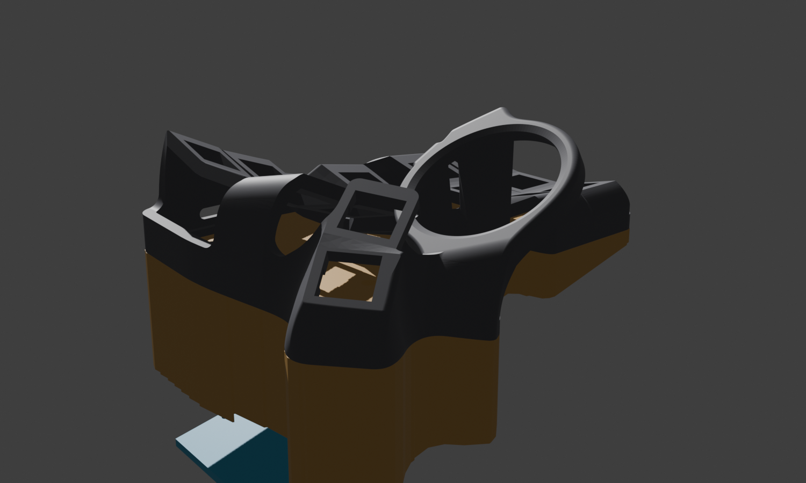
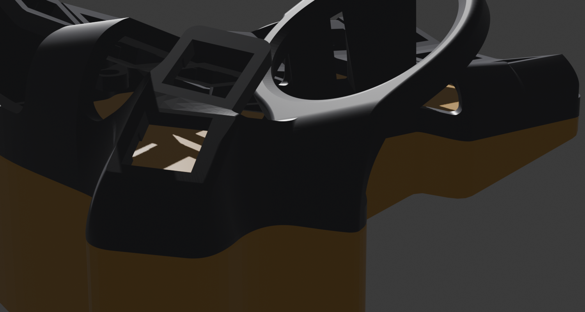
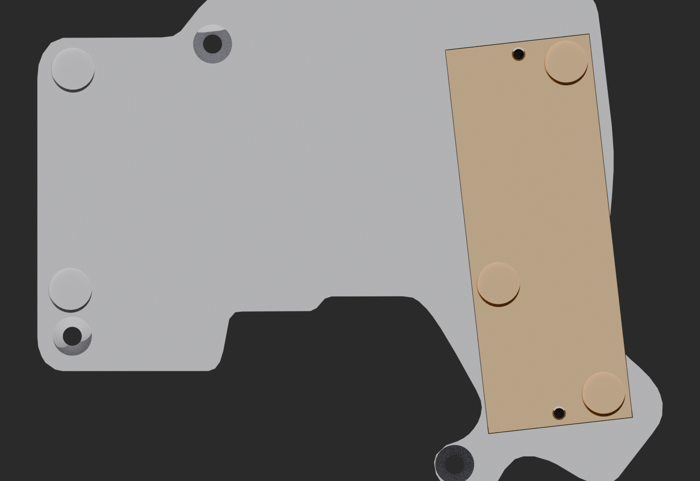

# Bodenplatte mit integriertem 18650-Fach

Ersetzt die flache Originalplatte durch ein Teil, das den Akku aufnimmt **und**
die Tenting-Neigung erzeugt. Oben plan (liegt am Case an), unten eine schiefe
Ebene: dick an der Daumen-/Innenseite, auslaufend nach aussen. Der Akku liegt
im dicken Bereich und wird von unten durch einen bündigen Deckel verschlossen.





## Ordner

| Ordner | Inhalt |
|---|---|
| `drucken/` | **die vier STL fuer den Slicer**, fertig gedreht |
| `cad/` | STEP + Konstruktionslage + Umrisse + Pruefskript |
| `bilder/` | Renderings und Schnittbilder |
| `alt/` | verworfene Pod-Variante und der erste Druckstand der Platte (`v1-fuesse-als-loecher/`) |

## Drucken

| Datei | Anzahl | Lage |
|---|---|---|
| `drucken/bodenplatte-rechts.stl` | 1 | Planflaeche auf dem Bett |
| `drucken/bodenplatte-links.stl` | 1 | dito |
| `drucken/akkudeckel-rechts.stl` | 1 | flach, 2,5 mm Scheibe |
| `drucken/akkudeckel-links.stl` | 1 | dito |

**Keine Stuetzen noetig.** Die Bodenplatte hat in Drucklage 114 cm2 Bettauflage.
Die gemeldeten 348 mm2 "Ueberhang" sind fast vollstaendig die umlaufende
45-Grad-Fase, die auf Bettniveau liegt und sich selbst traegt; der Rest sind die
Decken der beiden M3-Kernloecher und der Kabeldurchlass, die jeder Slicer
ueberbrueckt. Die Deckel liegen mit 31 cm2 plan auf, Ueberhang 0.

Empfehlung: 4 Waende, 10–15 % Infill. **Materialbedarf ca. 210 cm3 pro Platte** —
deutlich mehr als die 2-mm-Originalplatte, das ist der Preis fuer das
integrierte Fach.

## Kenndaten

| | |
|---|---|
| Aussenkontur | wie die Originalplatte, geglaettet (siehe unten) |
| Fase an der Oberkante | 0,8 mm, setzt die Platte sauber vom Case ab |
| Keil | **40 mm** innen auf **4 mm** aussen = **14,0 Grad** Neigung |
| Akkufach | 79,1 x 22,3 x 22,0 mm fuer den MPD BH-18650-W |
| Material zum Case hin | 2 mm |
| Kabeldurchlass | Ø8 mm nach oben ins Case |
| Schrauben | **3 je Haelfte**, Ø4,5 durch, **90-Grad-Senkung** fuer M4-Senkkopf |
| Gummifuesse | **5 je Haelfte**, Mulde Ø10,6 x 1 mm, senkrecht zur Keilflaeche |



### Schrauben und Fuesse — nachgemessen, nicht angenommen (14.10.2026)

Die erste Fassung hatte alle neun Positionen der Originalplatte als
Schraubenloecher gebaut. Beim Nachmessen der Originalplatten
(`bottom-plates/*.3mf`) stellte sich heraus:

| Position | im Original wirklich |
|---|---|
| 5 Stueck | **Mulde Ø10,4 x 1 mm, ohne Loch** — die Gummifuesse |
| 4 Stueck | **Senkloch**: Ø4,0 durch, 90-Grad-Kegel bis Ø8,0 — die Schrauben |

Die Fuss-Mulden waren also Durchgangsloecher, und die Schrauben hatten flache
Sacksenkungen statt Kegel — Senkkoepfe sassen nicht, es musste von Hand
nachgesenkt werden. Jetzt:

**Schrauben.** Ø4,5 durch, darunter ein 90-Grad-Kegel bis Ø9,2 (ein Kopf mit
Ø8,4 sitzt 0,4 mm unter dem Rand). Im dicken Bereich liegt die Kopfoberkante
7 mm unter dem Case, also ueberall **M4x12** (5 mm Gewinde im L5-Einsatz).
An der duennen Aussenkante entscheidet die Schraege: die Unterseite steigt
innerhalb des Kopfradius um 1,1 mm an, der Kopf muss auch an der hohen Seite
noch unter der Flaeche liegen — dort sitzt er 4,6 mm tief, es bleiben 2,3 mm
ueber dem Kegel, Schraube **M4x10** (1 je Haelfte, die Position an der
aeusseren Daumenecke).

**Eine Schraube je Haelfte fehlt absichtlich**: die Position bei
u ≈ 4 mm liegt mitten im Akkufach (rechts `(-93.99, 8.02)`, links
`(93.99, 8.00)`). Ihr Loch fuehrte in der ersten Fassung in den Hohlraum, und
der Deckel hatte keine Oeffnung — benutzbar war sie nie. Das Fach so weit nach
aussen zu ruecken, dass die Schraube durch den Deckelflansch passt, liesse am
aeusseren Deckelrand kaum 1 mm Wand. Drei Schrauben plus fuenf Fuesse halten
die Platte; der vierte Einsatz im Case bleibt leer.

**Fuesse.** Mulde Ø10,6 x 1 mm, senkrecht zur Keilflaeche geschnitten, damit
der Fuss plan sitzt. Fuenf der zehn Original-Positionen ueberlappen den
Akkudeckel um 2–4 mm, und in der inneren Ecke klemmen Deckelecke und
Plattenrand den Fuss so ein, dass kein Ausweichen auf der Platte moeglich ist
(der Bau bricht ab, sobald weniger als 1,5 mm Wand zur Kante bleiben).
Diese Fuesse sitzen deshalb **auf dem Deckel**, 1 mm von dessen Rand:

| | in der Platte | auf dem Deckel | Versatz |
|---|---|---|---|
| rechts | 2 | 3 | 8,4 / 8,4 / 9,2 mm |
| links | 3 | 2 | 7,7 / 7,7 mm |

Der Fuss drueckt den Deckel von unten in seinen Sitz — die Last geht in den
Flansch, nicht in die M3-Schrauben — und beim Akkuwechsel nimmt der Deckel
seinen Fuss mit, statt dass ein Fuss ueber die Fuge klebt.

Jedes dieser Merkmale wird beim Bau gegen seine Handrechnung geprueft:
Mulde = pi·r²·1 mm, Schraube = Kopfbohrung (mittlere Tiefe) + Kegelstumpf +
Durchgang. Eine Mulde, die in den Deckelsitz oder ueber die Kante schnitte,
entfernte weniger Material und liesse den Bau abbrechen.

**Deckel:** 2x M3x8, selbstschneidend in die Kernloecher (Ø2,5) im Flansch.

## Warum die Kante frueher geriffelt war

Der linke Original-Plattenmesh ist fragmentiert — beim Schneiden zerfaellt seine
Aussenkontur in **4551 offene Kettenstuecke**, eine saubere Konturverfolgung
scheitert daran. Deshalb wird der Umriss stattdessen **gerastert**: Die Silhouette
wird im Gitter abgetastet und per Marching Squares umfahren. Das erzeugt
zwangslaeufig Treppenstufen in Rastergroesse.

Beim ersten Wurf lag das Raster bei 0,6 mm und die Vereinfachung bei 0,35 mm —
die Stufen blieben als sichtbare Riffelung stehen. Jetzt:

* Raster **0,3 mm** statt 0,6
* gleitender Mittelwert (Fenster 9, zwei Durchgaenge) **vor** der Vereinfachung
* Douglas-Peucker mit **0,10 mm** statt 0,35
* Abschnitte unter 1,5 mm werden zusammengefasst (Splitter verhindern sonst die Fase)

Messbar: Die geglaettete Kontur weicht im Mittel **0,065 mm**, maximal 0,34 mm
von der Rasterkontur ab, und der Umfang faellt von 546 auf 537 mm — die
Differenz war reine Riffelung.

Die **0,8-mm-Fase** an der Oberkante ist der zweite Teil der Antwort: Sie zieht
die Plattenkante rundum um 0,75 mm zurueck (nachgemessen). Damit steht die Platte
an der Fuge garantiert nie ueber dem Gehaeuse, egal wie die Restabweichung
faellt — der Uebergang wirkt gewollt statt zufaellig.

## Zusaetzliche Teile je Keyboard

| Teil | Anzahl | Hinweis |
|---|---|---|
| **MPD BH-18650-W** | 2 | Digi-Key `BH-18650-W-ND`. Datenblatt Rev. G: *"designed for use with protected 18650 batteries (PCB)"* |
| protected 18650 | 2 | **nur geschuetzte Zellen**, siehe Warnung |
| M4x12 Senkkopf | 2 je Haelfte | dicker Bereich |
| M4x10 Senkkopf | 1 je Haelfte | aeussere Daumenecke (4–6 mm dick) |
| Gummifuesse Ø10 selbstklebend | 5 je Haelfte | wie bei der Originalplatte |
| M3x8 | 4 | Deckel, 2 je Haelfte |
| JST-PH-Stecker 2-pol | 2 | an die Halterdraehte, rot = + |

> [!WARNING]
> Die nRF52840-Boards haben **keinen Tiefentladeschutz**. Nur Zellen mit
> integrierter Schutzplatine verwenden. Eine vergessene, tiefentladene
> Li-Ion-Zelle ist Elektroschrott und beim Wiederladen ein Sicherheitsrisiko.

> [!IMPORTANT]
> Der Halter nimmt protected Zellen **bis ca. 69,4 mm** auf (Datenblatt nennt
> NCR18650B und Samsung 26J). Zellen messen und die passenden aussortieren.
> Ungeschuetzte Flat-Tops (65 mm) passen mechanisch, sind hier aber verboten.

> [!NOTE]
> Geladen wird ueber den Onboard-Lader mit ~100 mA. Eine 3000-mAh-Zelle braucht
> damit rechnerisch ~30 h fuer eine Vollladung — unkritisch bei Laufzeiten von
> Monaten, aber man laedt ueber Nacht nach statt auf "voll" zu warten.

## Aendern

Alles parametrisch in `build_plate.py`. Die wichtigsten Stellschrauben:

```python
T_IN  = 40.0   # Dicke innen  -> bestimmt die Neigung UND ob das Fach passt
T_OUT =  4.0   # Dicke aussen
BAY_U = 12.0   # Fachmitte, gemessen von der Schraubenachse nach innen
HOLDER_L, HOLDER_W, HOLDER_H = 77.7, 20.9, 21.31   # anderer Halter? hier messen
```

```bash
~/.claude/skills/parametric-brep-build123d/scripts/b3d build_plate.py
```

Das Skript prueft sich selbst und bricht ab, statt eine falsche Datei zu
schreiben. **Wichtig:** `T_IN` nicht beliebig senken — der Deckelsitz liegt
parallel zur Keilflaeche, seine Tiefe waechst also nach aussen. Wird der Keil zu
flach, bleibt am aeusseren Fachrand kein Flansch mehr stehen. Die Assertion
`Deckelsitz schneidet kein Material` faengt genau das ab.

## Geprueft

| Gate | Ergebnis |
|---|---|
| Keilvolumen gegen Handrechnung (Flaeche x Dicke im Flaechenschwerpunkt) | Abweichung **0,0004 %** |
| Akkufach trifft Material | per Volumendifferenz erzwungen |
| Deckelsitz schneidet Material | per Volumendifferenz erzwungen |
| Manifold / Shells (alle 4 Druckteile) | 0 non-manifold, 0 offen, **1 Shell** |
| B-Rep vs. STL | Tesselierungsfehler <= 0,0012 % |
| Ueberhang in Drucklage | Platte **233 / 209 mm2** (45-Grad-Fase auf Bettniveau und die 45-Grad-Senkkegel, beides selbsttragend), Deckel **0 mm2** |
| Jede Mulde und jede Senkung | Volumen gegen Handrechnung, Toleranz 1 % |
| Fuesse | mind. 1,5 mm Wand zur Kante, 1 mm zum Deckelrand, 0,5 mm zu jeder Schraube |
| Fase nachgemessen | Einzug **0,75 mm** an beiden Haelften (Soll 0,80 minus 0,05 Messversatz) |
| Konturglaettung | mittlere Abweichung **0,065 mm**, max 0,34 mm |
| Schraub- und Fusspositionen | aus den Originalplatten gemessen (Mulde vs. Senkloch unterschieden) |

`cad/gate_footprint.py` prueft zusaetzlich, ob ein Umriss innerhalb der
Original-Plattenkontur bleibt (mit Rot-Nachweis) — gebraucht, wenn du die
Fachposition verschiebst.

## Warum nicht ins Case?

Gemessen, nicht geschaetzt: Der Innenraum des Charybdis-Case ist durch
Stuetzrippen in Kanaele von **6–7 mm Breite** unterteilt; das groesste
zusammenhaengende Rechteck misst **7 x 49 mm** (Raycast, 1-mm-Raster, ueber die
ganze Flaeche). Eine 18650 braucht 18,4 mm Durchmesser. Deshalb nimmt auch der
Original-Build nur einen 4 mm flachen LiPo an der Innenkante. Die Rippen tragen
die Tastenmulde — wegfraesen schwaecht genau die Struktur, die sie steif haelt.

## `alt/` — verworfene Pod-Variante

Erster Ansatz: ein separates Akkufach, das unter die **unveraenderte**
Originalplatte geschraubt wird, plus aufklickbare Tenting-Fuesse auf einer
Schwalbenschwanz-Schiene. Funktioniert und war durchgeprueft, wirkt aber wie ein
angeschraubter Fremdkoerper. `alt/build_pod.py` baut sie bei Bedarf neu
(`b3d alt/build_pod.py`) — die erzeugten STL wurden entfernt, weil sie mit der
neuen Platte nicht kombinierbar sind.
