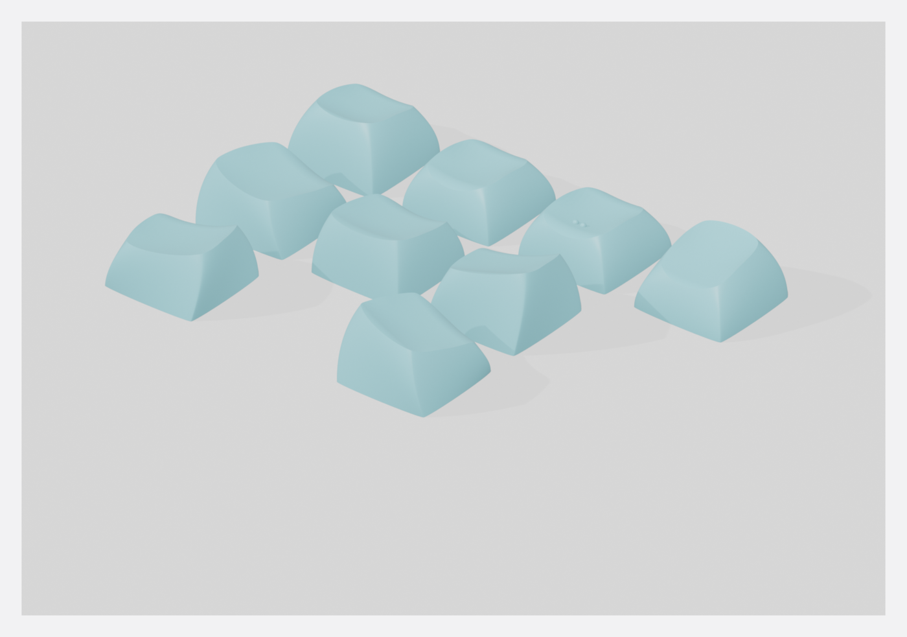

# DES-Keycaps — ohne Steg, fuer den eigenen FDM-Drucker

Die Originaldateien von [pseudoku](https://github.com/pseudoku/PseudoMakeMeKeyCapProfiles)
sind fuer **JLC3DP (SLS)** gebaut: je 10 Caps (Daumen: 6) haengen ueber einen
kurzen Steg an einer durchgehenden Leiste, damit die Gruppe als *ein* Teil
abgerechnet wird. Auf einem FDM-Drucker ist diese Leiste nur Ballast.

`drucken/` enthaelt dieselben Caps als **Einzelteile ohne Steg**, in Drucklage.



## Ordner

| Ordner | Inhalt |
|---|---|
| `drucken/` | die 9 STL **aufrecht** — schnell, kein Nacharbeiten, Mulde rauh |
| `drucken-quer/` | die 9 STL **in Schraeglage, ohne Fuss** — glatte Mulde, Stuetzen macht der Slicer |
| `drucken-quer-mit-fuss/` | dieselbe Schraeglage **mit angedrucktem Opferfuss** (Floss + Rippen), die bisherige Fassung |
| `jlc3dp-original/` | die Original-Leisten mit Steg, unveraendert (fuer eine SLS-Bestellung) |
| `bilder/` | Renderings |

**Welchen Ordner nehmen?** `drucken/`, wenn es schnell gehen soll.
`drucken-quer/`, wenn sich die Tasten unter dem Finger glatt anfuehlen sollen.
Der Unterschied ist unten ausgerechnet, nicht geschaetzt.

## Stueckzahl fuer 3 Keyboards

Pro Keyboard 41 Tasten: 3 Reihen x 6 Spalten x 2 Haelften = 36, dazu 5 Daumen
(linker Cluster 3, rechter 2 — die dritte Position nimmt der Trackball).

| Datei | pro Keyboard | **3 Keyboards** | Hinweis |
|---|---|---|---|
| `keycap-r1.stl` | 12 | **36** | oberste Reihe |
| `keycap-r2.stl` | 10 | **30** | mittlere Reihe |
| `keycap-r2-homing.stl` | 2 | **6** | mit zwei Tastnuppen, je 1 pro Haelfte |
| `keycap-r3.stl` | 12 | **36** | unterste Reihe |
| `keycap-daumen-a-L.stl` | 1 | **3** | Daumencluster |
| `keycap-daumen-b.stl` | 2 | **6** | symmetrisch, passt links wie rechts |
| `keycap-daumen-c-L.stl` | 1 | **3** | Daumencluster |
| `keycap-daumen-a-R.stl` | 1 | **3** | Spiegelbild von `a-L` |
| `keycap-daumen-c-R.stl` | 1 | **3** | Spiegelbild von `c-L` |
| | **42** | **126** | |

**126 statt 123**: Der Daumensatz ist als **Sechsersatz** konstruiert — drei
Formen, jede als Links/Rechts-Paar. Der rechte Cluster hat aber nur zwei
Tasten, also bleibt pro Keyboard **ein** rechtes Daumencap uebrig. Welches,
entscheidet sich erst beim Zusammenbau; deshalb alle sechs drucken. Kostet
1,4 cm3 Filament pro Keyboard.

Materialbedarf gesamt: **164 cm3 ≈ 204 g PLA** (≈ 68 m Filament) — die Caps
selbst sind in allen drei Ordnern identisch. In `drucken-quer/` kommen die
Slicer-Stuetzen dazu, in `drucken-quer-mit-fuss/` der Opferfuss (+24 %).

> [!TIP]
> Nicht 36 Dateien laden — **eine** Datei laden und im Slicer die Instanzzahl
> setzen (Bambu Studio / Orca: Rechtsklick → *Set number of instances*).
> 36 Caps im 21-mm-Raster sind 6 x 6 = **126 x 126 mm**, passt bequem aufs Bett.

## Drucklage aufrecht (`drucken/`)

**Die Caps stehen wie auf dem Switch: offene Unterseite auf dem Bett.
Keine Stuetzen.** Die STL sind bereits so gedreht — nicht umdrehen.

Das ist die unerwartete Richtung, deshalb die Messwerte dazu:

| | aufrecht (so ausgeliefert) | auf dem Kopf (Mulde unten) |
|---|---|---|
| Bettauflage | **98,7 mm2** (umlaufender Bodenring, 1,51 mm breit) | **0,019 mm2** |
| leere Winkelsektoren | 0 | fast alle |
| Ueberhang | 92–152 mm2 | 172 mm2 |

Die DES-Oberseite ist gemuldet **und** verwunden — ihr Rand liegt nicht in
einer Ebene. Kopfueber steht das Cap deshalb auf zwei Punkten und kippt. Das
uebliche „Keycaps druckt man umgedreht" gilt hier nicht.

Aufrecht dagegen:

* Die Schuerze verjuengt sich nach oben — **kein** Ueberhang an der Aussenwand.
* Die Hohlraumdecke spannt nur ~3 mm zwischen Stamm und Schuerze und ist
  beidseitig angebunden. Das ueberbrueckt jeder Slicer.
* Der Stamm waechst als Turm vom Bett nach oben. Seine Unterkante liegt
  **0,20 mm** ueber dem Bett (so konstruiert, Spiel zum Switch-Gehaeuse) — eine
  einzige Schicht in der Luft, die sich aufs Blech legt. Unkritisch.

Empfehlung: **Brim**. Der Bodenring ist zwar 98,7 mm2 gross, aber nur 1,51 mm
schmal und laeuft um 18 mm Kantenlaenge herum.

### Was daran stoert

Aufrecht ist die Mulde die **oberste** Flaeche. Beim FDM ist das die
schlechteste Lage, die es fuer eine Flaeche gibt, und zwar aus zwei Gruenden
gleichzeitig:

1. **Treppenstufen.** Eine geneigte Flaeche wird zur Treppe mit der
   Stufenbreite `w = Schichthoehe / tan(Neigung)`. Die DES-Mulde liegt
   groesstenteils bei 10–25 Grad:

   | Schichthoehe | Stufenbreite in der Mulde |
   |---|---|
   | 0,20 mm | **0,63 mm** |
   | 0,12 mm | 0,38 mm |
   | 0,08 mm | 0,25 mm |

   Eine Fingerkuppe nimmt etwa ab 0,3 mm eine Stufe als Riffel wahr.

2. **Infill statt Perimeter.** Alles flacher als ~25 Grad behandelt der Slicer
   nicht als Wand, sondern als *Deckflaeche* und fuellt es mit Infill-Linien.
   Das betrifft **59 % der Mulde** bei `keycap-r1` und **84 %** beim
   Daumen-Cap.

Beides zusammen ist der Grund, warum sich eine aufrecht gedruckte Taste unter
dem Finger merkwuerdig anfuehlt.

## Drucklage quer (`drucken-quer/`)

Eine Flaeche ist beim FDM genau dann glatt, wenn sie als **Wandperimeter**
gedruckt wird. Also wird das Cap so weit gekippt, dass die Mulde zur Wand
wird. Nicht kopfueber (das scheitert, siehe oben) — **quer**.

| Mulde | aufrecht | quer |
|---|---|---|
| Deckflaeche (Infill-Linien) | 59–84 % | **0 %** |
| Treppe | 16–41 % | 1–10 % |
| Wandperimeter (glatt) | **0 %** | **90–99 %** |

> [!WARNING]
> Leichtes Kippen macht es **schlechter**. Bei 40–60 Grad wandert fast alles in
> die Kategorie „Treppe", und die ist die groebste Oberflaeche von allen. Es
> gibt kein bisschen-besser, nur ganz oder gar nicht.

### Die Lage ist gemessen, nicht gewaehlt

`lage_suchen.py` sucht fuer jedes Cap die Richtung, die nach dem Drehen oben
sein soll. Zielgroesse: moeglichst viel Muldenflaeche im Wandfenster. Harte
Nebenbedingung: die **Fingerzone** — die um 1,5 mm von der Kante eingezogene
Mulde — muss **ohne Stuetzen** auskommen. Stuetzmarken auf der Fingerkuppe
waeren schlimmer als die Treppe, gegen die die ganze Uebung gerichtet ist.

Die Nebenbedingung ist strenger als noetig, mit Absicht: gefordert sind
mindestens **60 Grad Flaechenneigung** statt der 45 Grad, ab denen es
freitragend wird. Grund ist der Slicer, nicht die Physik — PrusaSlicer stuetzt
per Default alles flacher als 55 Grad. Eine Datei, die nur mit umgestellter
Slicer-Einstellung haelt, ist fragil. Die 60 Grad kosten 1–2 Prozentpunkte
Wandflaeche, bei den Daumencaps gar nichts.

Glatte 90 Grad waeren uebrigens schlechter als die gefundenen Winkel: bei
`keycap-r3` 82 statt 91 % Wand, und 4,8 % der Mulde braeuchten Stuetzen. Die
Ruecklage faengt den verwundenen Muldenrand ab.

### Ohne Fuss (`drucken-quer/`, seit 14.10.2026 der Normalfall)

In Schraeglage faellt die Bettauflage von 98,7 mm2 auf **0–0,24 mm2**. Das Cap
steht nicht, es balanciert — die Stuetzen setzt **Bambu Studio** (Baumstuetzen,
`tree(auto)`), das macht es besser und abloesbarer als ein angedruckter Fuss,
und 810 Rippen abknipsen entfaellt. Der tiefste Punkt jedes Caps liegt exakt
auf z = 0; sonst ist nichts veraendert: Volumen auf 0,0000 % gleich der
aufrechten Quelle.

Was der Slicer stuetzen muss (Ueberhang in Drucklage): r1 262, r3 226,
Daumen 189–301 mm2 — alles **Hohlraum und Schuerze**. Die Fingerzone ist per
Konstruktion stuetzenfrei (Gate 3) und bleibt es bei jeder Default-Schwelle.

> [!IMPORTANT]
> **Stuetzsperre ueber den Stamm legen.** Der Kreuzschlitz liegt quer, und
> Stuetzmaterial im 1,15-mm-Spalt bekommt man nie wieder heraus. In Bambu
> Studio: Stuetzsperre (Support Blocker) als Quader ueber den Stamm.

Die Gates fuer diese Fassung: 1–6 wie unten, 7 „steht auf dem Bett"
(|z| ≤ 2 um), 8 „Volumen unveraendert" (≤ 0,01 %), 9 Auflage nur als Info.

### Der Opferfuss (`drucken-quer-mit-fuss/`)

Die bisherige Fassung, mit `QUER_FUSS=1` neu erzeugbar. `keycaps_querlegen.py`
bringt dort einen Fuss an: ein 0,8 mm dickes Floss ueber dem ganzen Grundriss,
und darauf kegelstumpffoermige Rippen mit **0,7 mm Spitze** (0,49 mm2
Sollbruchstelle).

Der Gedanke dahinter: bei 0,06 mm2 Auflage baut der Slicer unter jedes der 126
Caps einen Turm und entscheidet selbst, wo er anfasst — jedes Mal anders, und
moeglicherweise auf der Mulde. Der Fuss ist Teil des Modells, also bei jedem
Druck identisch, und `gate_quer.py --mit-fuss` kann nachrechnen, dass er die
Fingerflaeche nicht beruehrt. In der Praxis hat sich das Abknipsen als der
groessere Aufwand erwiesen.

**Wo die Rippen anfassen duerfen:** nur Bodenring und Schuerze. Zusaetzlich
muss jede Rippe senkrecht von unten herankommen, ohne unterwegs an anderem
Cap-Material zu streifen.

| Datei | Kippung | Richtung | Rippen | Bruchnarben | Fuss |
|---|---|---|---|---|---|
| `keycap-r1.stl` | 73° | 269° | 6 | 3,1 mm2 | 290 mm3 |
| `keycap-r2.stl` | 71° | 270° | 4 | 2,1 mm2 | 270 mm3 |
| `keycap-r2-homing.stl` | 71° | 270° | 4 | 2,2 mm2 | 270 mm3 |
| `keycap-r3.stl` | 69° | 89° | 10 | 6,6 mm2 | 303 mm3 |
| `keycap-daumen-a-L.stl` | 76° | 222° | 6 | 4,3 mm2 | 496 mm3 |
| `keycap-daumen-a-R.stl` | 76° | 318° | 6 | 4,2 mm2 | 496 mm3 |
| `keycap-daumen-b.stl` | 76° | 311° | 5 | 3,6 mm2 | 500 mm3 |
| `keycap-daumen-c-L.stl` | 76° | 30° | 4 | 2,2 mm2 | 440 mm3 |
| `keycap-daumen-c-R.stl` | 76° | 150° | 4 | 2,3 mm2 | 440 mm3 |

### Punktkontakt gibt es nicht

Eine senkrechte Rippe der Breite *w* beruehrt eine schraege Wand ueber eine
Hoehe von `w · |n_horizontal| / |n_z|`. Gemessen faellt die Schuerze im Umkreis
einer halben Rippenbreite ueberall um 0,4–1,1 mm ab — sie ist eine schraege
Wand, kein lokales Minimum. Die Bruchnarbe ist deshalb kein Punkt, sondern ein
Fleck von rund 0,7 × 1 mm. Das ist die normale Angussnarbe, wie sie jeder
Harzdruck hat; sie wird begrenzt und gemessen, nicht wegdefiniert.

Die Narben sitzen auf der Schuerze (bei zwei Dateien auch am Bodenring, dort
sind sie unsichtbar — die Flaeche sitzt spaeter auf dem Switch). Der Fuss
reicht bis an die aeusserste Muldenkante heran, bleibt aber **1,2–1,8 mm von
der Fingerzone entfernt**.

### Was die Schraeglage kostet

| | aufrecht | quer |
|---|---|---|
| Bauhoehe | 8,5–12,6 mm | 19,8–25,2 mm |
| Grundriss | 18,1 × 18,1 mm (327 mm2) | 21,5 × 15,3 bis 25,8 × 23,3 mm (328–599 mm2) |
| Bettauflage | 98,7 mm2 | 328–599 mm2 (Floss) |
| Ueberhang (= Stuetzbedarf) | 92–152 mm2 | 160–298 mm2 |
| Material 126 Caps | 164 cm3 / 204 g | **204 cm3 / 253 g** (+24 %) |
| Nacharbeit | keine | **810 Rippen abknipsen** (4–10 je Cap) |
| MX-Kreuzschlitz | waechst als Turm | liegt quer — **Passung testen!** |

> [!CAUTION]
> **Erst ein Cap drucken, dann 126.** Der Kreuzschlitz hat nur 1,15/1,25 mm
> Spaltbreite. Quer gedruckt bekommen seine Flanken Schichtstufen und koennen
> durchhaengen — ein durchhaengender Schlitz ist ein engerer Schlitz. Das Gate
> prueft, dass die *Geometrie* unveraendert ist (Abweichung unter 2 µm); ob sie
> nach dem Durchhaengen noch auf den Switch passt, sagt nur der Switch.

### Slicer (Fussvariante)

* **Kein Brim, kein Raft.** Das Floss ist Teil des Modells.
* **Stuetzen an**, normale Stuetzen (nicht „nur auf der Platte"). Gebraucht
  werden sie fuer den Hohlraum, nicht fuer die Mulde — die ist per Konstruktion
  stuetzenfrei und bleibt es bei jeder gaengigen Default-Schwelle.
* **Stuetzsperre ueber den Stamm legen.** Stuetzmaterial im 1,15-mm-Schlitz
  bekommt man nie wieder heraus.
* Rippen mit einem Elektronik-Seitenschneider buendig abknipsen, nicht
  abdrehen.
* Instanzen: der Grundriss waechst durch das Floss. Reihen-Caps brauchen
  21,5 × 15,3…16,2 mm, Daumen-Caps bis 25,8 × 25,5 mm. 36 Reihen-Caps im
  6 × 6-Raster sind damit rund 140 × 110 mm — passt weiterhin bequem aufs
  Bett, aber nicht mehr mit dem 21-mm-Raster von `drucken/`.

## Kenndaten

| | |
|---|---|
| Grundriss | 18,07 x 18,07 mm (Daumen bis 18,32 x 18,35) |
| Hoehe | r1 11,00 / r2 8,54 / r3 10,57 / Daumen 10,19–12,59 mm |
| Wandstaerke Schuerze | 1,51 mm unten, 2,22 mm auf halber Hoehe |
| MX-Kreuzschlitz | 4,03 x 4,23 mm Arme, 1,15 / 1,25 mm Spaltbreite |
| Schlitztiefe | 5,25 mm (MX-Zapfen ist 3,6 mm hoch) |
| Homing-Nuppen | 2 Stk, je 0,88 mm2, **0,57 mm** hoch, bei x = ±0,75 / y = −3,97 |
| Dreiecke je Cap | ~52 000 (SLS-Aufloesung, unveraendert uebernommen) |

## Neu erzeugen

```bash
# aufrechte Variante: Leisten trennen
blender -b --factory-startup -noaudio -P keycaps_trennen.py

# Schraeglage: erst die Winkel suchen, dann drehen
python3 lage_suchen.py                                           # -> lagen.json
blender -b --factory-startup -noaudio -P keycaps_querlegen.py    # -> drucken-quer/ (ohne Fuss)
QUER_FUSS=1 blender -b --factory-startup -noaudio -P keycaps_querlegen.py   # -> drucken-quer-mit-fuss/
```

`keycaps_trennen.py` liest `jlc3dp-original/`, schreibt `drucken/`. Das Skript
bricht ab, statt eine falsche Datei zu schreiben: es prueft je Cap **1 Shell,
0 offene Kanten, positives Volumen** und die Anzahl der Teile je Leiste.

`lage_suchen.py` schreibt `lagen.json` (Kippung und Richtung je Cap),
`keycaps_querlegen.py` liest `drucken/` plus `lagen.json` und schreibt
`drucken-quer/` plus `fuss-bericht.json` (Rippenpositionen, Narbengroessen,
Schwerpunkt-Abstaende). Beim Entwickeln hilft `QUER_NUR=keycap-r2` (nur ein
Cap) und `QUER_DEBUG=1` (Ankersuche mitlesen).

### Warum zwei Schnitte — und warum der zweite ein Boolean ist

1. `z = -0,60` trennt die Caps voneinander; dort endet der Steg.
2. `z = +0,05` entfernt den Steg-Stummel unter dem Cap-Boden.

Schnitt 2 laeuft als **Boolean**, nicht als `bisect` + `holes_fill`. Der
Cap-Boden ist ein **Ring**, sein Rand besteht also aus zwei getrennten
Schleifen. `holes_fill` deckelt jede Schleife einzeln ab und macht daraus zwei
ineinandersteckende Huellen statt eines Koerpers. Das Ergebnis meldet
**0 non-manifold und 0 offene Kanten** — und ist trotzdem Muell. Gefunden hat
es nur der Shell-Zaehler.

Der Steg selbst hat einen einfachen Querschnitt, dort genuegt `holes_fill`.

### Warum der Fuss aus Einzelteilen gebooleant wird

Floss und Rippen ueberlappen sich. Als **ein** Mesh uebergeben ist der Operand
selbstdurchdringend, und das ist fuer den Boolean undefiniert: der erste
Versuch hatte einen Fuss mit 6 Shells, der MANIFOLD-Solver verschmolz die
Rippen mit dem Cap und liess das Floss als zweiten Koerper liegen. Jedes
Fussteil wird deshalb in einem eigenen Boolean angesetzt.

Nebenbefund, der eine Stunde gekostet hat: **die Polygonzahl taugt hier nicht
als Treffer-Nachweis.** Beide Solver verschmelzen koplanare Dreiecke, die Zahl
sinkt also auch bei einer geglueckten Union (52 132 → 51 693 bei `keycap-r1`).
Der Beweis ist das Volumen je Teilschritt plus die Shell-Zahl.

## Geprueft

### `drucken/` — aufrecht

| Gate | Ergebnis |
|---|---|
| Manifold / offene Kanten / Shells (alle 9) | 0 / 0 / **1 Shell**, Volumen positiv |
| Auflage + leere Sektoren in Drucklage (alle 9) | **98,67 mm2**, **0** leere Sektoren |
| MX-Kreuzschlitz gegen Toleranzfenster | Arm 4,03/4,23 mm, Spalt 1,15/1,25 mm — im Fenster |
| Rot-Nachweis des Schlitz-Gates | mit unerfuellbarem Fenster fallen alle 9 durch |
| Steg vollstaendig entfernt | tiefster Punkt = Bodenring, Stamm bei z=0,20 |
| Homing-Nuppen erhalten | 2 Cluster nachgemessen, 0,57 mm hoch |

```bash
blender -b --factory-startup -noaudio -P gate_mx_stamm.py
blender -b --factory-startup -noaudio -P gate_mx_stamm.py -- --rotnachweis
python3 ~/.claude/skills/print-mesh-gates/scripts/verify_stl.py drucken/keycap-r1.stl
python3 ~/.claude/skills/print-mesh-gates/scripts/downfacing_probe.py drucken/keycap-r1.stl
```

### `drucken-quer/` — Schraeglage ohne Fuss (14.10.2026)

`gate_quer.py` prueft die **exportierten** Dateien, ohne Blender und ohne die
Buchfuehrung des Erzeugers: die Fingerzone wird dort eigenstaendig neu
bestimmt. **Alle 9 Dateien, alle 9 Gates gruen (81/81); im Rot-Nachweis mit
absichtlich unerfuellbaren Fenstern wird keine einzige Zeile gruen.**

| Gate | gemessen ueber alle 9 Dateien | Fenster |
|---|---|---|
| 1 Manifold | 1 Shell, 0 offen, 0 vierfach | genau so |
| 2 Fingerzone unverformt | 0,0–0,7 µm | ≤ 5 µm |
| 3 Fingerzone stuetzenfrei | **0,0000 mm2** flacher als 60° | = 0 |
| 4 Fingerzone ist Wand | 96,5–97,2 % | ≥ 90 % |
| 5 Muldenkante | 0 µm (kein Boolean mehr) | ≤ 350 µm |
| 6 Kreuzschlitz heil | 0,0–1,4 µm | ≤ 5 µm |
| 7 steht auf dem Bett | tiefster Punkt +0,0000 mm | \|z\| ≤ 2 µm |
| 8 Volumen unveraendert | 0,0000 % gegen die aufrechte Quelle | ≤ 0,01 % |
| 9 Auflage | 0–0,24 mm2 (Info) | — |

### `drucken-quer-mit-fuss/` — Schraeglage mit Opferfuss

Dieselbe Pruefung mit `--mit-fuss`; Stand unveraendert, alle Gates gruen:

| Gate | gemessen ueber alle 9 Dateien | Fenster |
|---|---|---|
| 1 Manifold | 1 Shell, 0 offen, 0 vierfach | genau so |
| 2 Fingerzone unverformt | **0,0–0,9 µm** | ≤ 5 µm |
| 3 Fingerzone stuetzenfrei | **0,0000 mm2** flacher als 60° | = 0 |
| 4 Fingerzone ist Wand | **96,5–100 %** | ≥ 90 % |
| 5 Muldenkante begrenzt | 1–332 µm | ≤ 350 µm |
| 6 Kreuzschlitz heil | **0,3–1,4 µm** | ≤ 5 µm |
| 7 Bettauflage | 328–599 mm2 | ≥ 60 mm2 |
| 8 Kippsicherheit | Schwerpunkt +6,8…+11,0 mm innen | ≥ 2 mm |
| 9 Rippen fern der Kuppe | **1,34–3,17 mm** | ≥ 1,20 mm |

```bash
python3 gate_quer.py                  # drucken-quer/ (ohne Fuss)
python3 gate_quer.py --rotnachweis
python3 gate_quer.py --mit-fuss       # drucken-quer-mit-fuss/
python3 ~/.claude/skills/print-mesh-gates/scripts/verify_stl.py drucken-quer/*.stl
```

**Warum der Export jetzt selbst nachprueft.** Ohne Fuss gibt es keinen
Boolean, und die SLS-Quelle bringt je Cap 300–500 Sliver unter 1e-6 mm2 mit.
Die Hygiene-Kette LOESCHT ein entartetes Dreieck (Loch), flickt das Loch, und
der 5-um-Weld am Ende erzeugt an derselben Stelle wieder eines — bei
`keycap-daumen-a-L` drehte sich das im Kreis. Jetzt werden solche Reste
kollabiert statt geloescht, danach laeuft eine volle Runde nach, und die
**exportierte Datei** wird mit `verify_stl.py` geprueft; bei Befund wird sie
geloescht statt geschrieben. Genau das hat beim ersten Lauf eine STL mit
1 non-manifold-Kante (`keycap-daumen-c-L`) abgefangen.

### Was die Gates NICHT sagen

* **`downfacing_probe.py` meldet bei `drucken-quer/` leere Winkelsektoren.**
  Das ist ein Tessellierungs-Artefakt, kein Befund: der Test sortiert pro
  Kontakt-**Dreieck** in 72 Sektoren, und der Floss-Boden ist eine ebene
  Rechteckflaeche, also genau **2 Dreiecke** mit 328–599 mm2. Zwei
  Schwerpunkte koennen hoechstens zwei Sektoren fuellen — der Test kann hier
  konstruktiv nicht gruen werden. Die Information, fuer die er gedacht ist,
  steckt in Gate 7 (Auflageflaeche) und Gate 8 (Schwerpunkt darueber).
* **Gate 5 erlaubt ausdruecklich Abweichung.** Auf der aeussersten Muldenkante
  schmelzen die Rippen an, dort weicht die Flaeche bis 332 µm ab. Die
  Fingerzone beginnt 1,5 mm weiter innen; dort sind es unter 1 µm.
* **Kein Gate prueft die Passung zum Switch.** Gate 6 belegt, dass die
  Schlitz-*Geometrie* unveraendert ist. Ob der quer gedruckte Schlitz nach dem
  Durchhaengen noch passt, sagt nur ein Testdruck.

> [!NOTE]
> Die Caps sind unveraendert in Form und Mass — entfernt wurde nur der Steg,
> und in `drucken-quer/` kommt ein abknipsbarer Fuss dazu. Wer sie in SLS
> bestellen will, nimmt `jlc3dp-original/` wie gehabt.
